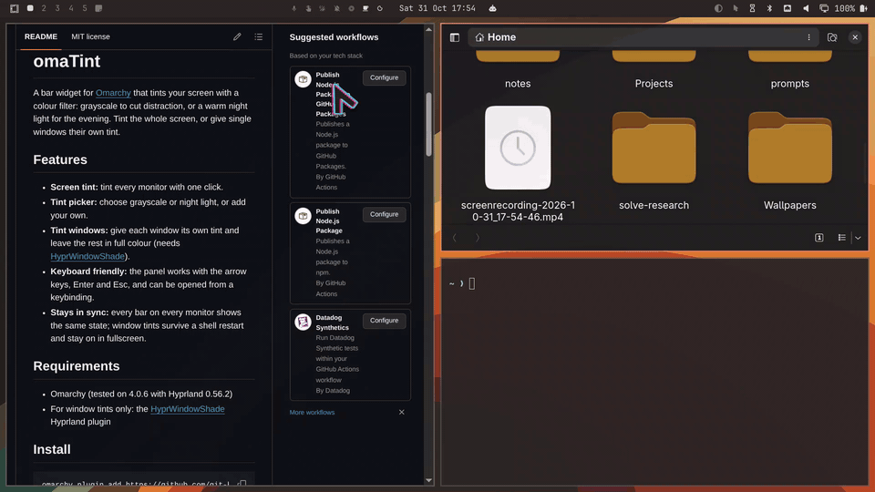

# omaTint

A bar widget for [Omarchy](https://omarchy.org/) that tints your screen with a
colour filter: grayscale to cut distraction, or a warm night light for the
evening. Tint the whole screen, or give single windows their own tint.

## Features

- **Screen tint:** tint every monitor with one click.
- **Tint picker:** choose grayscale or night light, or add your own.
- **Tint windows:** give each window its own tint and leave the rest in full
  colour (needs [HyprWindowShade](#tint-windows-hyprwindowshade)).
- **Keyboard friendly:** the panel works with the arrow keys, Enter and Esc,
  and can be opened from a keybinding.
- **Stays in sync:** every bar on every monitor shows the same state; window
  tints survive a shell restart and stay on in fullscreen.



## Requirements

- Omarchy (tested on 4.0.6 with Hyprland 0.56.2)
- For window tints only: the
  [HyprWindowShade](https://github.com/ManofJELLO/HyprWindowShade) Hyprland
  plugin

## Install

```bash
omarchy plugin add https://github.com/git-blah/omaTint.git --enable
```

The widget appears in the right-hand section of the bar. To move it:

```bash
omarchy bar move omaTint --section left
```

## Usage

| Action       | What it does               |
| ------------ | -------------------------- |
| Left-click   | Turn screen tint on or off |
| Middle-click | Switch to the next tint    |
| Right-click  | Open the panel             |

The panel has three parts:

- **Header:** shows whether screen tint is on and which tint it uses. The
  switch turns screen tint on or off.
- **Tint:** the tint you pick here is used for screen tint and for the next
  window you click.
- **Tint windows:** lists your open windows. Pick a tint, then click a window:
  - an untinted window gets the picked tint;
  - a window with a different tint switches to the picked one;
  - a window that already has the picked tint goes back to full colour.

  Each tinted window shows its tint on the right. **Clear all** removes every
  window tint.

While screen tint is on, the window list is blurred and can't be changed.
Window tints are kept, and show again when screen tint is turned off.

### Keyboard

| Key           | What it does                      |
| ------------- | --------------------------------- |
| ↓ / ↑ (j / k) | Move between the switch and rows  |
| Enter / Space | Use the highlighted switch or row |
| Esc           | Close the panel                   |

To open the panel from a keybinding, bind a key to:

```bash
omarchy-shell shell summon omaTint '{}'
```

## Tint windows: HyprWindowShade

Window tints use HyprWindowShade, a Hyprland plugin that applies shaders to
single windows. Without it the panel shows a notice in place of the window
list; screen tint still works.

```bash
hyprpm add https://github.com/ManofJELLO/HyprWindowShade
hyprpm enable HyprWindowShade
```

HyprWindowShade is native code that runs inside Hyprland. Read its README
before installing it.

To check that Hyprland has actually loaded it, use `hyprctl plugin list`.
`hyprpm list` only shows what hyprpm manages, so a plugin loaded another way
can show as disabled there and still be running.

To tint a window, omaTint briefly focuses it, then puts focus and the cursor
back where they were. It records each window's tint as a window tag,
`window_tint:<file>`; see them with:

```bash
hyprctl -j clients | jq '.[] | {class, tags}'
```

## Adding tints

Every `.glsl` file in [`shaders/`](shaders/) appears in the panel as a tint;
the panel shows the file name with a capital letter and without `.glsl`. Each
file is a Hyprland screen shader (GLSL ES 3.2). Use
[`shaders/grayscale.glsl`](shaders/grayscale.glsl) as a template:

```glsl
#version 320 es
precision mediump float;
in vec2 v_texcoord;
layout(location = 0) out vec4 fragColor;
uniform sampler2D tex;

void main() {
    vec4 pix = texture(tex, v_texcoord);
    // change pix.rgb here
    fragColor = pix;
}
```

If the screen doesn't change, run `hyprctl configerrors` to see shader
compile errors.

Renaming or removing a file doesn't update windows already tinted with it;
clear their tint first.

## Known issues

- **Brief flicker when the screen tint changes.** This happens in Hyprland
  itself; setting `screen_shader` with plain `hyprctl` flickers the same way.
- **Other widgets that set a screen shader conflict with omaTint.** Other widgets can write to Hyprland's `screen_shader` setting, so
  running both makes them overwrite each other. Use one at a time.

## Troubleshooting

**The widget isn't in the bar.** Look for a load error in the shell log:

```bash
journalctl --user --since "5 min ago" | grep -i omaTint
```

If the code has changed but the bar still shows the old version, run
`omarchy restart shell`.

**The screen is stuck tinted.** This always clears the screen tint:

```bash
hyprctl eval 'hl.config({decoration = {screen_shader = ""}})'
```

**A window stays tinted.** Turn screen tint off, then use **Clear all** in the
panel.

## Development

```bash
bash tests/check.sh
```

This validates the manifest with `omarchy plugin validate`, compiles each
shader with `glslangValidator` (if installed), and runs the Node tests in
[`tests/`](tests/). Run only the tests with `node --test tests/*.test.mjs`.

| File                         | Purpose                                                                 |
| ---------------------------- | ----------------------------------------------------------------------- |
| [`Service.qml`](Service.qml) | One per shell: tint state, the list of windows, and the `hyprctl` queue |
| [`tint.qml`](tint.qml)       | The bar icon and panel; every bar binds to the service                  |
| [`lua.js`](lua.js)           | Builds the Lua sent to `hyprctl eval`, and parses `hyprctl` output      |
| [`shader.js`](shader.js)     | Turns a shader file name into the name shown in the panel               |
| [`shaders/`](shaders/)       | The tints listed in the panel                                           |
| [`tests/`](tests/)           | Unit tests and the check script                                         |

## Credits

Window tints are powered by
[HyprWindowShade](https://github.com/ManofJELLO/HyprWindowShade) by
[ManofJELLO](https://github.com/ManofJELLO) (MIT license). omaTint doesn't
include its code; you install it separately with `hyprpm`.

## License

[MIT](LICENSE) © 2026 git-blah
